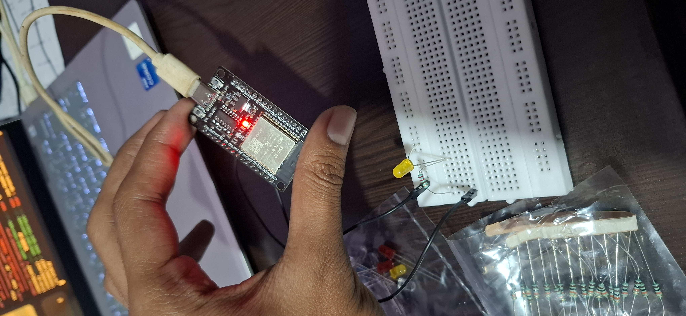
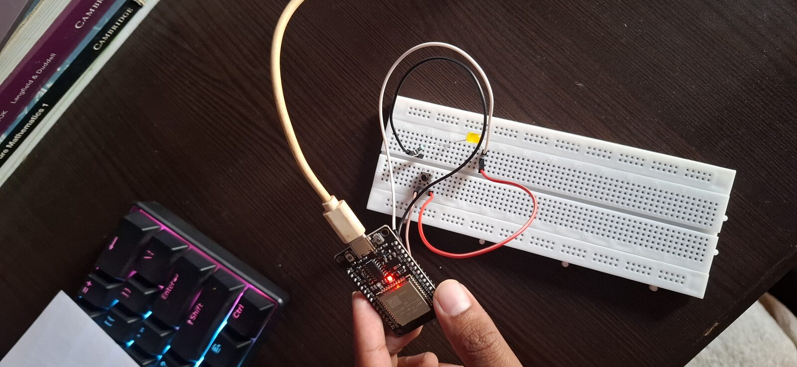

# Week 1: GPIO, Blink & Breadboard Fundamentals

This repository contains my Week 1 progress for the 52-week Embedded Systems curriculum. 

## Contents
- `blink.py`: MicroPython script to blink the onboard LED (GPIO2).
- `notes/`: Handwritten formulas and breadboard logic.
- `docs/`: Toolchain setup notes and ESP32 strapping pin research.

## Status
- [x] Toolchain (esptool, mpremote) installed and verified.
- [x] Blind code written and tested in simulator.
- [ ] Hardware verified (ESP32 arriving tomorrow).

## Hardware Verification (Nov 18)

Today I successfully flashed MicroPython to the ESP32 and verified the hardware using a multimeter.

### Measurements
| Measurement | Theoretical | Measured | % Error |
| :--- | :--- | :--- | :--- |
| 3V3 Rail | 3.30 V | [Your 3V3 reading] V | [Calculate] % |
| Divider Midpoint (10k/10k) | 1.65 V | [Your divider reading] V | [Calculate] % |
| Voltage across 220 Ω | ~1.3 V | 1.15 V | ~11.5 % |
| LED Current | 5.9 mA | 5.23 mA | 11.3 % |

## 19 Nov: Debounced Push-Button Input (`dry_tank_polling.py`)
- **Circuit:** Tactile push button on `GPIO 4` (internal `Pin.PULL_UP` enabled, active-low to `GND`) and status LED on `GPIO 13` with a `220 Ω` current-limiting resistor.
- **Debounce Logic:** `20 ms` double-read state verification (`while True` polling) to filter mechanical contact bounce.
- **Bench Result:** Verified 100% single-toggle response per press with zero flicker.

### Gallery

